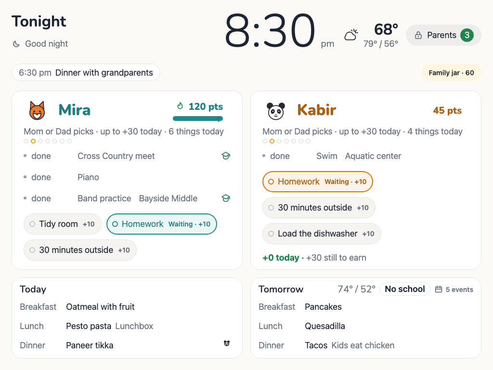
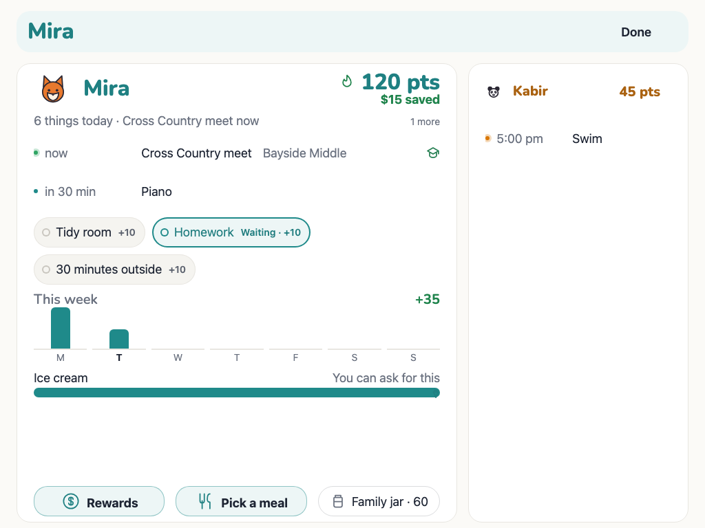
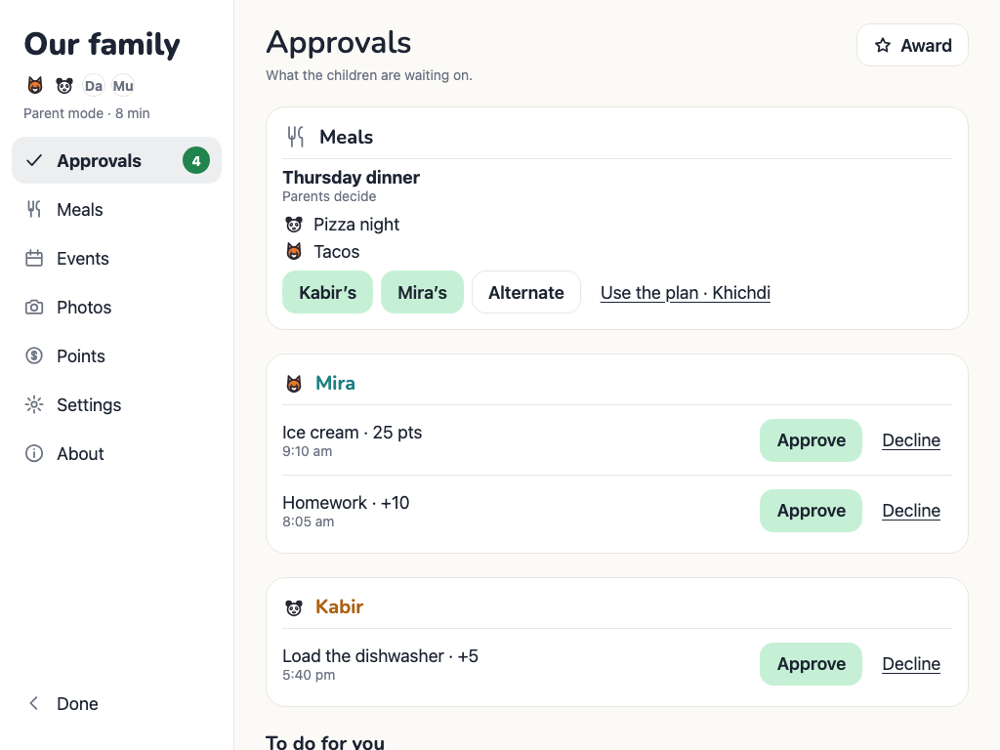
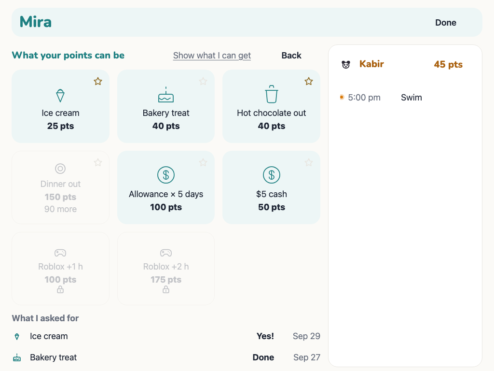
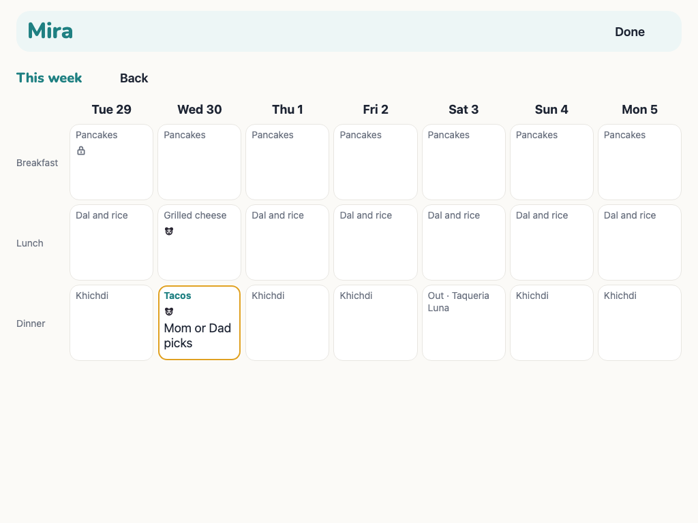
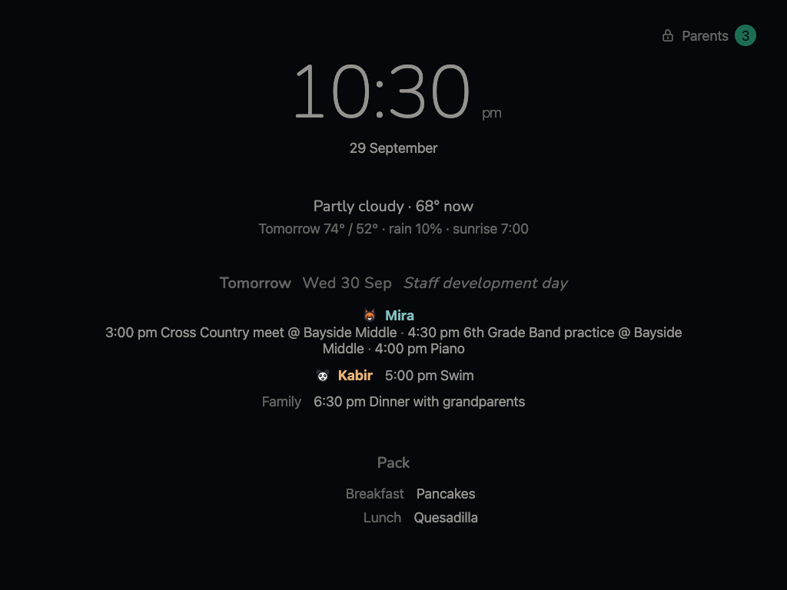
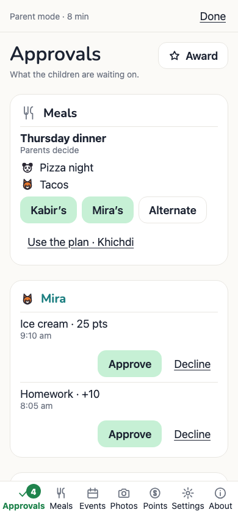

# Mantel

A family dashboard for the iPads that would otherwise sit in a drawer. Mounted
in the kitchen or the living room, it shows the day: each child's plans and
chores, the family's calendar, the weather, and what everyone is eating. After
hours it turns into a calm night screen, and when nobody has touched it for a
few minutes it becomes a photo frame. The children claim their chores on it and
spend the points in a small shop; a parent approves from the wall or a phone.
It runs on a Mac on the home network: a small Python API reads plain YAML files
and serves a React front end to the iPads.

<table>
  <tr>
    <td width="50%"></td>
    <td width="50%"></td>
  </tr>
  <tr>
    <td width="50%"></td>
    <td width="50%"></td>
  </tr>
  <tr>
    <td width="50%"></td>
    <td width="50%"></td>
  </tr>
  <tr>
    <td width="50%"></td>
    <td width="50%"></td>
  </tr>
</table>

**Try it:** `make demo` serves a fictional family — Mira and Kabir — with a
fortnight of history, on http://localhost:8140/ (parent PIN 1234, the children's
codes 1111 and 2222). Nothing is fetched from anywhere.

**Privacy.** There are no accounts, no cloud service, no analytics and no
third-party scripts; every font and icon is bundled. No language model or any
other model sits in any decision: what the screen shows, what a chore is worth
and what a child may pick are all rules in files you can read. The only
requests that leave the house fetch your calendars and a weather forecast.
Photos come from the Photos app on the Mac, or from a folder you drop them in.
The family's own data — content, points, photos — lives in `home/` on the Mac
and is never committed.

## Layout

    home/           the family's own state, git-ignored (MANTEL_HOME): content/,
                    photos/, cache/, backups/ and the ledger, mantel.db
    content.sample/ a fictional family — make demo, the smoke suite and the tests
    scripts/        the demo, and the sample's calendars and photos
    services/api/   FastAPI (Python 3.11), package mantel_api
    apps/kiosk/     Vite + React 18 + TypeScript, targeting iPadOS 17+
    deploy/         the launchd agents: the API, and the nightly photo sync
    inbox/          drop photos here for the next sync to pick up
    tests/smoke/    the browser smoke tests, on content.sample/
    docs/           the iPad setup guide, and later.md for parked ideas

## Requirements

- Node 20.19+ or 22.12+
- [uv](https://docs.astral.sh/uv/) — it fetches Python 3.11 itself, so no
  system Python setup is needed

## Running it

    make dev

That installs anything missing, then runs the API on `:8000` and the kiosk on
`:5173` with `/api` proxied to the API, so the iPad only needs one host:port.
Both listen on the LAN; the URLs are printed on startup. Ctrl-C stops both.

- `http://<lan-ip>:5173/` — "Mantel" and a live clock
- `http://<lan-ip>:5173/diag` — device and API diagnostics
- `http://<lan-ip>:8000/api/health` — API health, including content status
- `http://<lan-ip>:8000/api/config` — family and settings
- `http://<lan-ip>:8000/api/today` — one assembled day
- `http://<lan-ip>:8000/api/weather` — the cached forecast

Vite proxies `/api/*` and nothing else, so `/openapi.json` is not reachable
through `:5173`. To list the routes, ask the API directly:

    curl -s localhost:8000/openapi.json |
      python3 -c "import sys,json; print('\n'.join(sorted(json.load(sys.stdin)['paths'])))"

## Other commands

    make check    ruff, mypy, pytest, tsc --noEmit, eslint
    make build    bundles the kiosk into services/api/static/
    make serve    one process on :8000 serving the build and the API
    make smoke    drives the built app in a browser (see below)
    make photos   sends the Photos album "Mantel" and inbox/ to the frame

`make check` must pass before any prompt is considered finished.

## Running it for real

`make build` bundles the kiosk into `services/api/static/`, and the API serves
it from `/`: the bundle, the icons, and `index.html` for anything else, so
reloading `/diag` on the iPad still loads the app. `/api/*`
is untouched underneath. One process, one port, no Vite:

    make build
    make serve                    # http://<lan-ip>:8000/

`make serve` is the by-hand version, for looking at a build. The iPads need
something that starts itself and comes back after a reboot. Two ways, same app.

### Working on it while the service is installed

Once `com.mantel.api` is installed it holds port 8000 with whatever code it
started with, and `make dev` cannot have it. The rule is three lines:

    launchctl bootout gui/$(id -u)/com.mantel.api      # while you work
    make dev                                          # reloads on a Python edit
    make build && launchctl bootstrap gui/$(id -u) \
      ~/Library/LaunchAgents/com.mantel.api.plist      # done for the day

`make dev` refuses to start on a taken port rather than losing it silently: it
names the process holding :8000, says whether launchd or a terminal owns it,
and prints the exact `bootout` line when it is the service.

It runs uvicorn with `--reload` watching `services/api/mantel_api`, so an API
edit is live without a restart. **It deliberately does not watch `home/content/`**:
the API already re-reads YAML there on its own whenever a file changes, and a
process restart would drop a parent-mode session in the middle of editing the
meals.

A later `make build` is picked up without restarting anything — the files are
read per request. The iPads themselves reload at `daily_reload` (04:00), so a
build made in the evening is on the wall by breakfast. To push one out sooner,
bump `VERSION`: the kiosk notices the new version and reloads, but only from
the photo frame and only after a minute there, so nobody watches it blink.

### a. As a Mac service

This is how it runs at home — on the MacBook now, on a Mac mini later. Nothing
in it is specific to either.

    make install-service          # writes and loads com.mantel.api
    make uninstall-service        # stops it and removes the plist

There are two agents. **`com.mantel.api`** is the API itself, below.
**`com.mantel.photos`** is the nightly photo sync: at 21:00 it runs
`deploy/photos-sync.sh`, which exports the Mantel album from Photos and uploads
it, and logs one line to `~/Library/Logs/mantel/photos.log`. See the photos
section. `make uninstall-photos-service` removes it.

`make install-service` renders `deploy/com.mantel.api.plist.template` into
`~/Library/LaunchAgents/com.mantel.api.plist` and loads it. From then on the API
starts at login, restarts if it crashes (but stays down when stopped on
purpose), and writes to `~/Library/Logs/mantel/`:

    tail -f ~/Library/Logs/mantel/api.log         # the whole log, timestamped
    tail -f ~/Library/Logs/mantel/api.err.log     # only written if it dies

    launchctl print gui/$(id -u)/com.mantel.api   # is it running?
    launchctl kickstart -k gui/$(id -u)/com.mantel.api   # restart it

If it does not come up, the log says why. The usual cause is port 8000 already
being held by `make dev` or a container — `make install-service` refuses in
that case rather than leaving launchd restarting it every ten seconds, so stop
the other one first:

    make down                                    # or Ctrl-C the `make dev`
    lsof -nP -iTCP:8000 -sTCP:LISTEN             # what is holding it

It is a **user** agent, not a system daemon: it starts when you log in, not
when the Mac boots. If the Mac is ever restarted, log in and leave it logged
in. (Set the Mac to log in automatically if it lives in a cupboard.)

### The Mac must not sleep

A sleeping Mac is two blank iPads, and it is the single most likely way for
Mantel to be "broken" in the morning.

- **System Settings → Energy** (a Mac mini or a plugged-in desktop): turn on
  **Prevent automatic sleeping when the display is off**, and set the display
  to sleep whenever you like — the Mac stays awake.
- **A laptop** has no such setting on battery, and closing the lid sleeps it.
  Keep it plugged in, and either leave the lid open or run:

      caffeinate -dimsu           # hold it awake until Ctrl-C

  To make that survive a reboot, add a second launchd agent for `caffeinate`,
  or move Mantel to the Mac mini, which is what the mini is for.

Wi-Fi may also drop when the display sleeps on an older Mac; if the iPads show
an amber "updated" chip overnight, that is the first thing to check.

### b. In Docker

    make up                       # build if needed, then run on :8000
    make down

`Dockerfile` builds the kiosk with Node and runs the API on `python:3.11-slim`
as a non-root user. `docker-compose.yml` mounts the data folder, so a changed
meal needs no rebuild, and reads `.env` if it is there. The host address, port
and data folder come from the environment (`MANTEL_BIND`, `MANTEL_PORT`,
`MANTEL_HOME`). Same app: the iPads cannot tell which way it is running.

**Production is Albert**, the house's Linux server, which runs this container
from a tagged release: **docs/DEPLOY.md** has the settings, the data folder,
the health address and how to upgrade. Docker is not installed on Jarvis.

## On the home network

The iPads need one address that does not change.

**1. Find the Mac's LAN IP.** `make dev`, `make serve` and `make up` print it.
By hand:

    ipconfig getifaddr en0        # usually Wi-Fi
    ipconfig getifaddr en1        # Ethernet, or a dock

**2. Reserve it on the router.** Open the router's admin page (often
`http://192.168.1.1`), find DHCP reservations — also called static leases or
address reservations — and tie that IP to the Mac's Wi-Fi hardware address
(System Settings → Network → Wi-Fi → Details → Hardware). Without this the Mac
picks up a different IP after some future power cut, and both iPads go blank
with no explanation.

**3. Name the Mac `jarvis`.** Bonjour then advertises it by name, so the iPads
never have to hold an address at all:

    sudo scutil --set HostName jarvis
    sudo scutil --set LocalHostName jarvis
    sudo scutil --set ComputerName jarvis
    dscacheutil -flushcache

Mantel is then at **http://jarvis.local:8000** — the URL to put on the iPads.
(Sentinel shares the name on :8001. Once Mantel runs on Albert, the iPads use
**http://albert.local:8000** instead; see docs/DEPLOY.md.)
Bonjour only works within one network, so keep the iPads and the Mac on the
same Wi-Fi (not a guest network, not a separate IoT SSID). If `jarvis.local`
ever stops resolving, the reserved IP still works: `http://192.168.1.x:8000`.
That is what the reservation is for.

### There is no HTTPS

Mantel is served over plain HTTP. Nothing in the house needs a certificate:
only the API reaches the internet, the secrets stay in `.env` on the Mac, and
the kiosk only talks to the API.

What that costs is worth stating plainly, because it rules out two things
people reach for: **iOS gives service workers and real PWA installation only to
HTTPS origins**, so Mantel cannot register a service worker and cannot be
installed as an offline app. It does not need to be. **Add to Home Screen**
still gives a full-screen icon with no Safari chrome, Guided Access pins the
iPad to it, and the app already survives the API being unreachable by keeping
the last good response on screen.

If Mantel is ever reachable from outside the house, this stops being true and
HTTPS comes before anything else.

## Content

`home/content/family.yaml` and `home/content/settings.yaml` are validated by Pydantic on
every request. A malformed file never takes the API down: the error and its
path are logged, the last good version keeps being served, and
`/api/health` reports `content.<file>: "error: ..."`.

## Points

Tapping a chore does not award anything. It makes a claim, and a claim is a
request until a parent decides on it — which is the whole design, and the
reason the kids can be trusted with the tap.

    kid taps a to-do row in kid mode   ->  claim, status "claimed"
    the row fills in their colour      ->  "Waiting for Mom or Dad"
    parent taps Approve                ->  one ledger row, actor "parent"
    parent taps Decline                ->  nothing written at all

Two properties hold everywhere else in the system:

* **The ledger is append-only, and SQLite enforces it.** Triggers refuse
  UPDATE and DELETE on `ledger` rows, so the rule survives a stray `sqlite3`
  session on the Mac. A wrong row is answered by appending its opposite —
  that is what `refund` and `adjust` are for.
* **A balance is always `SUM(delta)`.** It is never stored and never cached,
  so it cannot drift from the rows that produced it.

Points are held when a child *asks* for a reward, not when they get it, so a
balance never shows points that are already spoken for. A decline returns
them as its own row.

The database is `home/mantel.db`. It is git-ignored, because it is the
house's own record rather than content, and a copy is taken once a day into
`home/backups/` with fourteen kept. The copy uses SQLite's backup API
rather than `cp`: a file copied mid-write lands half-written.

### Tuning tasks.yaml

    mira:
      weekdays:
        - {id: hw, title: Homework, points: 5}
        - {id: read, title: Read 20 minutes, points: 5}
        - {id: room, title: Tidy room, points: 5, claim: parent, every: week}
      weekend:
        - {id: read, title: Read 20 minutes, points: 5}
        - {id: sketch, title: Make a sketch, points: 5}

Each child has two lists. `weekdays` is Monday to Friday when there is
school; `weekend` is Saturday and Sunday, and any weekday without school — a
holiday is a day off, whatever it is called. A task in both lists must be
written the same way in each. `points` is what approving it is worth.
`claim: parent` marks a task a child cannot honestly report on themselves: it
shows a lock in kid mode and does not respond to a tap. `every: week` makes a
task once a week (Monday to Sunday): it can be claimed on any day of its list
until a parent approves it, pays once, and shows done for the rest of the week.

Only the every-day tasks of the day's list count towards a streak; a weekly
job cannot break one. A day that asked nothing is stepped over rather than
counted against, and today never breaks a streak, because a streak checked at
breakfast would be broken by homework due in the evening.

`settings.yaml` holds the rest:

    points: {streak_bonus: 20, streak_days: 7, roblox_per_week: 2,
             deductions: false, parent_idle_minutes: 2}
    banks: {cash_out_min_cents: 2000, roblox_use_sizes: [30, 60, 120]}
    allowance: {amount_note: "set in settings", reminder_hour: 18}

### Tuning rewards.yaml

    - {id: ice_cream, name: Ice cream, cost: 30, fulfilment: manual,
       glyph: ice-cream}

`fulfilment` is what approving one actually does:

| value | what happens |
| --- | --- |
| `manual` | a card on the parent Approvals tab until somebody ticks it off |
| `meal` | the child picks a meal, and it goes into `meals.yaml` |
| `allowance` | one reminder a day for `days` days, at `allowance.reminder_hour` |
| `bank` | `dollars` into the child's piggy bank, or `minutes` into their Roblox bank, the moment a parent says yes |
| `policy` | screen time granted by the policy plane; nothing uses it until v4 |

`family: true` is paid out of the family jar rather than one child's balance.
`enabled: false` shows the card greyed with "Coming soon" instead of hiding
it — a reward a child cannot see is a reward they cannot save towards. A file
that still says `fulfilment: cash` means `bank`.

A child may ask for the same reward again while an earlier ask is still
waiting, as long as the points cover it: each ask is its own redemption,
holding its own points. The shop tile counts them ("Asked · 2").

Approving a reward is not finishing it: the ice cream still has to be bought.
`fulfilled` means somebody actually did the thing.

### The bank

Each child has two banks: a piggy bank in cents and a Roblox bank in minutes.
They are one table, `bank`, kept by the same rules as the ledger — SQLite
triggers refuse UPDATE and DELETE, and a balance is `SUM(delta)` per child and
account, never stored. Every row says why it exists: a `deposit` (an approved
reward), a `cashout`, a `use` of Roblox time, or a parent's `adjust`.

    parent approves "$5 cash"          ->  points (held at the ask) stay spent,
                                           one deposit row of 500 cents
    child taps "Cash out $20"          ->  a request that holds $20,
                                           "Pay Mira $20" in To do for you
    parent hands it over, taps Paid    ->  one cashout row of -2000
    parent taps Decline instead        ->  the hold ends; nothing written

Money goes in when a parent says yes and comes out only when a parent has
actually handed it over. A cash-out offers the whole balance rounded down to
$5, and only once that reaches `banks.cash_out_min_cents` ($20 by default);
under it the button says how much more to save.

Roblox time works the same way. A child asks for one of
`banks.roblox_use_sizes` (30 min, 1 h or 2 h), as long as it is in the bank
and they have used fewer than `points.roblox_per_week` this ISO week. The ask
holds the minutes and becomes "Give Kabir 60 min of Roblox today"; Done writes
the use row. In v4 the request goes to the
[policy-plane](https://github.com/ankgoyal-itus/policy-plane) instead, which
grants the time on the device by rule. The row, the hold and the weekly cap
stay as they are; only who hands the time over changes.

A child sees both balances as chips under their points in kid mode, and as a
caption under their points on the wall ("$15 saved · 2 h Roblox"); each chip
opens that bank. A parent sees both on the Points tab, with the last twenty
rows, and can Adjust either one for birthday money or a correction — a row of
its own with a note, never an edit. Cash rewards approved before the bank and
never paid moved into it, once, as `system` deposits.

### Setting a kid PIN

Parent mode → Settings → Kid codes. Four digits, or Clear to remove one. With
no code set, tapping a child's face opens their card straight away.

This is a latch on a sibling, not security: four digits has ten thousand
values and anyone who can reach the iPad can try them all. It is stored as
PBKDF2-HMAC-SHA256 with a per-row salt, which adds no dependency and makes no
claim it cannot keep. The parent PIN is a different thing and lives in `.env`
as `MANTEL_PARENT_PIN`.

### The weekly digest

`GET /api/digest?week=2026-W39` returns each child's week — points earned and
spent, chores approved by day, rewards, money and Roblox time in and out of
their banks, meal picks — counted from the ledger, the bank and the claims.
It is rendered as a plain card on the parent Points tab.
Nothing in it is generated: no LLM is in this or any other path.

## Outside sources

The API is the only thing that talks to the internet; the kiosk only talks to
the API.

**Weather** comes from Open-Meteo and needs no key. It is fetched for the
location in `settings.yaml` every 15 minutes and cached. If a fetch fails the
last good reading keeps being served, marked `stale: true`, and `/api/health`
says so. See `GET /api/weather`, and the same object under `weather` in
`/api/today`.

**Calendars** are Google Calendar ICS feeds, one per entry in the `calendars:`
block of `settings.yaml`. Each entry names an environment variable rather than
a URL, because the URL is a secret: anyone holding it can read that calendar.
Feeds are refreshed every `refresh_minutes` and expanded for today-1 to
today+14. A feed whose variable is empty is skipped and shown as
`not configured` in `/api/health`.

To get a feed URL:

1. Open Google Calendar on a computer and hover the calendar in the left list.
2. Click the three dots, then **Settings and sharing**.
3. Scroll to **Integrate calendar**.
4. Copy **Secret address in iCal format** (the one ending in `basic.ics`).

Paste it into `.env` under the matching name:

    MANTEL_CAL_MIRA=https://calendar.google.com/calendar/ical/.../basic.ics
    MANTEL_CAL_KABIR=
    MANTEL_CAL_FAMILY=

Treat that URL like a password. If one leaks, use **Reset** next to the secret
address in Google Calendar to invalidate it, then paste the new one here.

## Photos

**Since 0.3.0 the photos belong to Memories**, the photo frame app on :8002
(`ankgoyal-itus/memories`, beside this repo). Memories takes the uploads, runs
the pipeline (upright, 2048px JPEG, metadata stripped, the town's name from a
GPS fix), keeps the store and deletes. Mantel reads the same folder, read-only,
so its iPads' frame shows exactly what it did:

    GET    /api/photos            the list, newest first (unchanged)
    GET    /api/photos/{id}.jpg   the file, cached for a year (unchanged)
    POST   /api/photos            410 Gone: {"detail": ..., "moved_to": "<Memories>/api/photos"}
    DELETE /api/photos/{id}       410 Gone, the same

The folder is `MANTEL_PHOTOS_DIR`, else `home/photos/`; on Albert it is
Memories' photo folder mounted read-only (`MANTEL_PHOTOS` in compose;
docs/DEPLOY.md). Memories' address for the 410 is `MANTEL_MEMORIES_URL`,
default `http://albert.local:8002`. A catalogue that will not parse is logged
and the last good list keeps serving; Mantel never writes to the folder.

`make photos` (and the `com.mantel.photos` agent, nightly at 21:00) still takes
the **Mantel** album out of Photos on this Mac, but sends it to Memories:
`MANTEL_PHOTOS_URL`, default `http://albert.local:8002`, with the header
`X-Memories-Token` and the token `MEMORIES_UPLOAD_TOKEN` (else
`MANTEL_UPLOAD_TOKEN`) from `.env`. If nothing answers there, it stops before
sending anything and the album waits for the next night.
**[docs/photos.md](docs/photos.md)** sets up the Mac and the phone Shortcut.

## Calendars, holidays and school days

The feeds are listed in `settings.yaml`, each with a `kind` (and an optional
`name` for the parent screen):

| kind | what it is | URL lives in | window | refresh |
| --- | --- | --- | --- | --- |
| `kid`, `family` | our own Google calendars | `.env`, because the URL is a password | today−1 … +14 | `refresh_minutes` |
| `holiday`, `festival` | public Google holiday calendars | `settings.yaml` | today−31 … +183 | daily |
| `school` | the district's and each school's own feed | `settings.yaml` | today−31 … +365 | hourly |

The 31-day look-back is not padding: a ten-day festival is named once, on its
first day, so a restart on day nine has to be able to see that day. The school
window is a full year because a year read in September has its last day in
May, and without that the summer would never end.

**No dates are typed into `home/content/` anywhere.** School holidays, minimum days,
term bounds and vegetarian days are all derived from the feeds and written to
`home/cache/`, which is git-ignored. Those caches are read at startup, so a
feed being down, slow or rewritten never changes what the iPad shows.

### Finding the school feeds

Many US district and school sites run on Finalsite, which serves iCal at
`<site>/fs/calendar-manager/events.ics?calendar_ids[]=<id>`. The ids are not
published anywhere: the "Calendar RSS Feeds" link on each page is `href="#"`
and filled in by JavaScript. They are, however, in the markup of the calendar
element itself. To find one:

    curl -s https://<your-district-site>/district/calendars/districtcalendar \
      | grep -o 'data-calendar-ids=[0-9]*'
    # data-calendar-ids=30

then confirm the feed answers:

    curl -s 'https://<your-district-site>/fs/calendar-manager/events.ics?calendar_ids%5B%5D=30' \
      | head -1
    # BEGIN:VCALENDAR

Without `calendar_ids` the endpoint returns 401, so the id is required. A
school that is not on Finalsite usually has an "Add to calendar" or iCal link
on its calendar page instead. A feed whose `url` is still `DISCOVER` is
reported as `not configured` and simply contributes nothing, and a feed can
also be a local `.ics` file, as the sample family's are.

### What is derived from them

**School days** come from the school-kind feeds only. All-day events whose
titles match `no school|holiday|break|recess|staff development|professional
development|non-student|teacher work day` become days off, and a multi-day
event blocks every day it spans. `minimum day|early release|early dismissal`
sets a note without closing the school, carrying the grades the district names
— "Minimum day (TK-5)" — because a TK-5 early release is not every child's.
`first day of school` and `last day of school` bound the year; outside them the
note is "Summer", and with no bounds ever found `/api/health` says
`school_year: bounds unknown` and every weekday is a school day.

Feeds only ever *add* days off. A school's own calendar can close for a day the
district keeps, never the other way round.

The district feed is for closures and bounds only — its board meetings and
candidate forums stay off a dashboard meant for two children. The two school
feeds do put their events on the matching kid's rows, drawn with a small
school-house glyph.

**Observances** — holidays and festivals — are not appointments and never
appear on an agenda. They go in a per-day `observances` array, de-duplicated by
name across feeds, because the Indian and Hindu calendars both carry Diwali,
Holi and Navratri. `GET /api/observances?days=183`.

**Vegetarian days** come from `diet` in `settings.yaml`, which holds rules
rather than dates: the weekday rule, plus festival names matched as
case-insensitive substrings of an observance, each with how many days it runs
forward. Navratri is named once on 11 October and `span_days: 10` carries it
through Dussehra on the 20th. `GET /api/diet?days=183` shows the computed set
with its reasons, and today's is on `/api/today` as `diet`.

## The panchang

A Hindu almanac day, computed on this Mac and never fetched. `GET
/api/panchang?date=…` gives one day; `GET /api/panchang/month?ym=2026-10`
gives a month of calendar cells; the kiosk's MONTH screen — tap the date in
the day or night header — draws them.

The five limbs are read **at local sunrise**, which is what makes a panchang
day a day: a tithi that ends at nine in the morning is still that morning's
tithi, which is why the almanac and the wall calendar disagree about when a
day begins.

    vaara      the weekday
    tithi      moon minus sun in 12° steps, thirty to a lunar month
    nakshatra  the moon's own position, 13°20' steps, twenty-seven to a circle
    yoga       moon plus sun, in the same steps
    karana     half a tithi, cycling through eleven names

Sidereal longitudes with the **Lahiri** ayanamsa, from the Swiss Ephemeris via
`pyswisseph`, using its built-in **Moshier** model — so there are no ephemeris
data files to ship, download or keep.

`settings.yaml` carries only the naming:

    panchang: {masa_scheme: purnimanta, show_yoga_karana: false}

**purnimanta** is the North Indian reckoning, where a lunar month turns at the
full moon; **amanta** turns at the new moon. It changes what the dark fortnight
is called and nothing else: Diwali's new moon is Kartik under purnimanta and
Ashwin under amanta. An adhika (leap) month is detected where the sun changes
no sign between two conjunctions.

A month of cells is cached in `home/cache/panchang-YYYY-MM.json`, keyed by
a hash of the place and the naming scheme, so moving house or switching scheme
rebuilds it and nothing else does. Only the astronomy is cached — observances,
school days, diet and meals are folded in per request, because those move with
the feeds while the sky does not. A cold month takes about 0.4 s here.

### Credit and licence

The Swiss Ephemeris (via pyswisseph) is AGPL-3.0, so running Mantel anywhere but
your own network brings AGPL obligations.

The algorithms follow the approach of **drik-panchanga**
(https://github.com/webresh/drik-panchanga, AGPL-3.0): the sunrise-anchored
day, naming a month by the solar sign at the conjunction that opened it, and
the two-conjunctions-in-one-sign test for an adhika masa. No code was copied —
`mantel_api/panchang.py` is our own, and finds end times by bisection where the
reference interpolates.

**The Swiss Ephemeris is AGPL-3.0**, and so is that project. On a home network
this asks nothing of us. But AGPL section 13 covers use over a network, so if
Mantel were ever served to anyone outside the house — the Cloud Run idea parked
in `docs/later.md` — its source would have to be offered to those users.

## Where a photo was taken

The "Lake Tahoe · June 2024" caption's place is resolved by Memories at import,
from its bundled GeoNames gazetteer (CC BY 4.0; attribution in Memories'
README). Mantel only shows the `place` that is already in the catalogue.

## The design language

Everything the screens look like is decided in two files:
`apps/kiosk/src/theme.css` and `apps/kiosk/src/copy.ts`. Nothing outside
theme.css defines a colour or a size step, and nothing outside copy.ts holds a
string the six screens share.

### Two palettes

Day is paper — a warm off-white wall at `#FBFAF7`, white cards with a hairline
and a soft lift, ink at `#1D2433`. Night is the same meanings dimmed, and the
switch at the night window is the whole "lights out" moment. The night screen
is dark because a white wall display at ten at night is a lamp.

Each meaning has **three forms**, because a colour chosen to be seen across a
room is not a colour you can write in — Kabir's amber `#D97706` is 3.2:1 on white:

| form | what it does | example |
| --- | --- | --- |
| `--kid-kabir` | fills: dots, accents, the claimed row, the avatar disc | `#D97706` |
| `--tint-kabir` | carries: a surface a word sits on | the colour at 8% over white |
| `--ink-kabir` | writes: the same colour as letters | darkened until it clears 4.5:1 |

A pill is a tint with the page's own ink on it. **No word is ever white on a
colour.** The two kid forms are derived from `family.yaml` at runtime by
`shell/tint.ts`, so changing a child's colour keeps it readable without anyone
picking a second value. `shell/kidPalette.ts` writes each child's forms, for
day and night, as a stylesheet keyed on the same attribute as `theme.css`,
because a palette that only changes when React re-renders can be caught a
frame behind.

### What moves

Six things, and nothing else: the frame's crossfade and drift, the wake, the
PIN pad's shake, one 600ms bounce when a balance changes, one 400ms avatar nod
as a card opens, and one 250ms slide shared by the month panel, the shop and
the picker — so there is one way things open. The confetti is a canvas rather
than an animation: one 900ms burst over one card when a parent says yes.
Everything respects `prefers-reduced-motion`.

### What the suite holds it to

`make check` runs `tests/design/`, which renders every state at both iPad
sizes **and under both palettes** — 58 passes — and asserts:

- nothing overflows the stage, and nothing scrolls but the three screens that
  are allowed to
- nothing is cut off: not by hanging out of a card, not by being squeezed
  inside one, and not by a line crushed under its own line-height
- every text node a kid reads is 20px or larger, every tap target 44x44
- contrast clears AA on paper (4.5 body, 3 large, decided by axe from the
  rendered size) and AA-large against the night palette
- no word is white on a tint
- only the six animations above are running
- nothing is requested from anywhere but the API

A screenshot per state and palette lands in `docs/screens/` and is committed,
so a design change shows up as a picture in the diff.

## Secrets

Copy `.env.example` to `.env` and fill it in. `.env` is git-ignored: secrets
never enter the repo and never reach the kiosk. The API reads it at startup,
so a change needs a restart.

## Keeping the screen on

The kiosk asks for a screen wake lock and re-requests it whenever the page
becomes visible again. Safari has had the API since 16.4, and the bug that
broke it inside installed web apps was fixed in 18.4, so on these iPads
(18.7.9) it does hold.

It is still not the whole answer, because a wake lock dies with the tab. The
device settings are:

- **Settings → Display & Brightness → Auto-Lock → Never**
- **Guided Access** (Settings → Accessibility → Guided Access), started with a
  triple-click of the home or top button, pins Safari to the kiosk and stops a
  stray swipe leaving it.

Auto-Lock is what keeps the screen up when Safari is backgrounded; the wake
lock covers the foreground.

## iPad setup

Both iPads are wiped, set up as kiosks, and pinned to Mantel with Guided
Access. The whole procedure is a checklist in **[docs/ipad-setup.md](docs/ipad-setup.md)**,
including the settings that matter (Auto-Lock Never, Do Not Disturb, Night
Shift), how to check the result on `/diag`, and what to do when something is
wrong in the morning.

## The smoke test

    make smoke

Builds the kiosk, serves it with `content.sample/` on port 8123, and drives
it in Playwright's bundled Chromium at 1024x768: the day dashboard renders the
fixture content, fast-forwarding past `idle_minutes` reaches the photo frame,
and a tap returns to the dashboard. Screenshots land in `docs/screens/`, which
is git-ignored — they are output, not documentation.

The first run downloads Chromium (about 180 MB) into the Playwright cache.

It checks layout and wiring, not Safari. Before the browser starts it also
checks that every file `index.html` names is actually in the build, because a
stale or half-written `index.html` is a white iPad with nothing in the log.
Chromium is not Safari 18, so the iPads remain the last word.

## Status

Versions 1 to 3 are done and running every day on two iPads: the dashboard,
the night screen and the photo frame; points, chores, rewards and the parent
screen; meal picking, the month and the list; each child's piggy bank and
Roblox bank. Next is the handshake with
[policy-plane](https://github.com/ankgoyal-itus/policy-plane), so that the
Roblox time a child uses from their bank is granted there, on the device, by
rule, instead of by a parent's Done.

Mantel was built with Claude Code; the essay about building it is
[here](https://ankitskgoyal.com/writing/a-concierge-engineer-for-the-house/).

